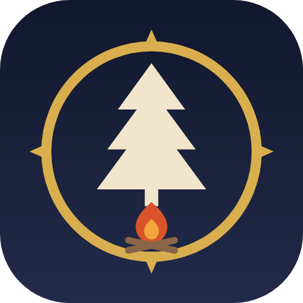
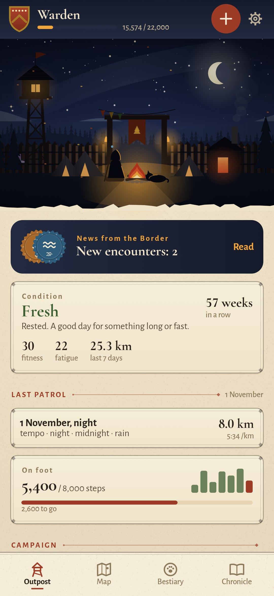
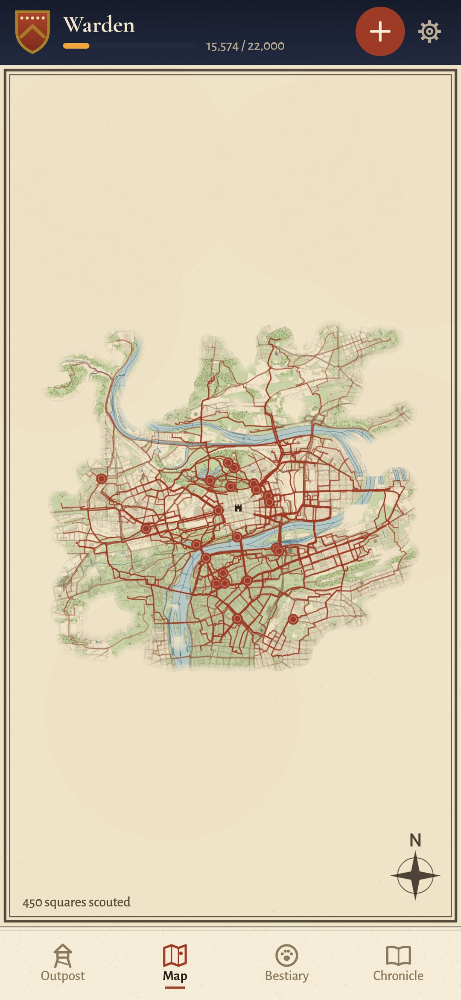
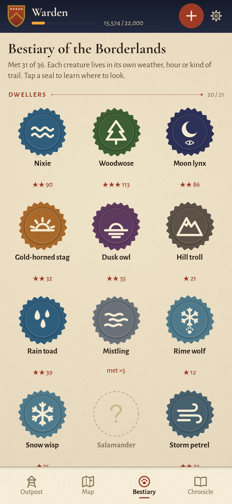
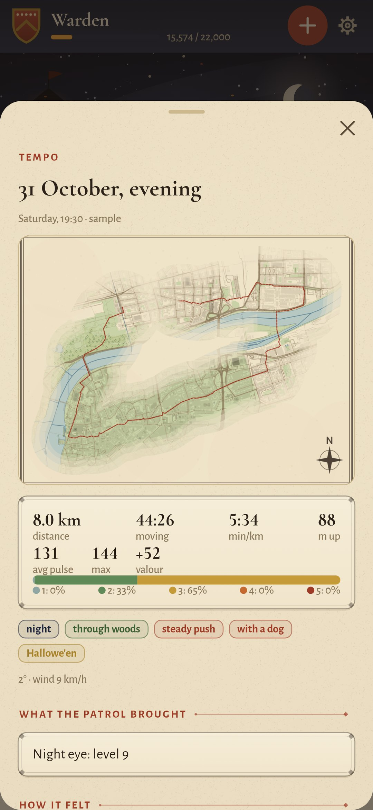

<div align="center">



# Ranger

### A running journal where every run is a patrol on the edge of the kingdom

*You are a ranger of the Borderlands. Runs come in from Health Connect, your watch or a Strava archive and become patrols. Who you meet depends on the run itself: rain, fog, sunrise, a full moon, a river along the way, climbs, an easy pulse or surges. The outpost grows with your rank, and the map shows only the land you have already run through. Free, no ads, no accounts.*

[](https://github.com/bigdevwhale/ranger/actions/workflows/android.yml)
[](https://github.com/bigdevwhale/ranger/releases/latest)


[](LICENSE)

**English** · [Русский](README.ru.md) · [Changelog](CHANGELOG.md)

   

**[Download the APK](https://github.com/bigdevwhale/ranger/releases/latest/download/Ranger.apk)** · Android 9+

</div>

---

## Where runs come from

- **Health Connect.** Strava, Garmin, Samsung Health, Mi Fitness, Zepp, Polar and Coros write there. The app reads runs with their route and heart rate, plus morning resting pulse, heart-rate variability and daily steps.
- **Files.** GPX, TCX and FIT from any watch, gzipped or zipped too.
- **A Strava archive.** Settings → My account → Download or delete your account, then the whole zip: years of runs arrive at once, shoes included.
- **Recording here** with GPS when there's no watch, or a run typed in by hand.

When the same run arrives twice, one copy stays: the one with the track and the pulse.

## The bestiary

36 creatures live in the Borderlands, each with its own conditions. The Nixie appears along water, the Moon Lynx in the dark, the Gold-horned Stag at sunrise. The Hill Troll waits on climbs, the Windchaser is only caught with surges, and the Whisperer shows herself to whoever runs quietly in the easy zones. Rare visitors include the Will-o'-the-wisp (night and rain) and the Werewolf (full moon); legends include the Frost Unicorn at a frozen dawn, the Elder Dragon at thirty kilometres and the Firebird on Midsummer night.

A common creature takes a few patrols: first tracks, then the lair, then the meeting. Weather comes from the run's place and time (Open-Meteo), sun and moon are worked out on the phone, and water, parks and woods along the way come from OpenStreetMap.

## Ranks, abilities and condition

- **Valour** is training load (TRIMP): time weighted by how high the pulse was; without a pulse, from pace and climb. An easy hour and a hard half-hour count about the same. Walking adds a little too.
- **Ten ranks**, Recruit to Legend of the Borderlands. Each adds to the outpost: a palisade, a watchtower, a gate with a banner, a forge, a stone wall, a keep, a beacon on the hill.
- **Nine abilities**, each from its own kind of effort: endurance, speed, night eye, mountain path, grit in foul weather, quiet step, tracker's sense, constancy, and Wayfarer for days at your step goal.
- **Condition** from six-week fitness against one-week fatigue. When load rises too fast or the resting pulse is up in the morning, the healer suggests a rest.

## Outpost, map, chronicle

- **The outpost** is a camp under the real sky: moon phase, time of day and season match. Companions' tents, your dog asleep by the fire, retired shoes on the wall, pennants from races over the gate.
- **The map** is drawn on parchment from OpenStreetMap, showing only what your trails have scouted, with seals where creatures were met. Tracks are cut around home and work.
- **Campaigns**: goals over a few weeks, such as the Old Road (80 km in a month), the High Pass, the Night Watch or the Quiet Step.
- **The chronicle**: calendar, weekly kilometres, heart-rate zones and the easy share, fitness and fatigue, resting pulse, steps, and best times for 1, 5 and 10 km, the half and the marathon.
- **Boots, band and bard.** Every pair of shoes has its mileage; companions get roles from how you run together; the app can note what played in your headphones and tell you what you run faster to.

## Privacy

Everything stays on the phone. No accounts, ads or analytics. Only map tiles (OpenFreeMap) and weather (Open-Meteo) are requested for the coordinates of your runs. Health Connect is only read, never written. Music is noted from the player's notification, and only if you allow it.

## Build

```
./gradlew assembleDebug                      # app.ranger.dev, next to a real install
./gradlew assembleDebug -Pdemo               # app.ranger.demo: a year of patrols around Letná, Prague
./gradlew testDebugUnitTest                  # GPX/TCX/FIT/Strava, conditions, the bestiary, steps
./gradlew testDebugUnitTest -Prender --tests '*RenderScreens*' --rerun && python tools/shots.py   # screenshots
python tools/demo_routes.py                  # rebuild the demo routes, elevation and tiles
```

Kotlin, Jetpack Compose, Room, DataStore, Health Connect. The outpost scene, the seals and the map are drawn in code. Fonts: Cormorant and Alegreya Sans (SIL OFL). Map data © OpenStreetMap contributors (ODbL), tiles by OpenFreeMap, weather by Open-Meteo (CC BY 4.0).

Part of [StillCraft](https://bigdevwhale.github.io/stillcraft/). MIT licence.
