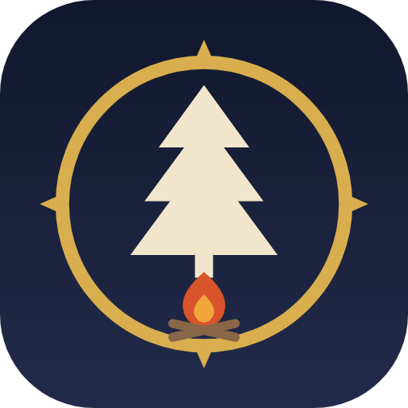
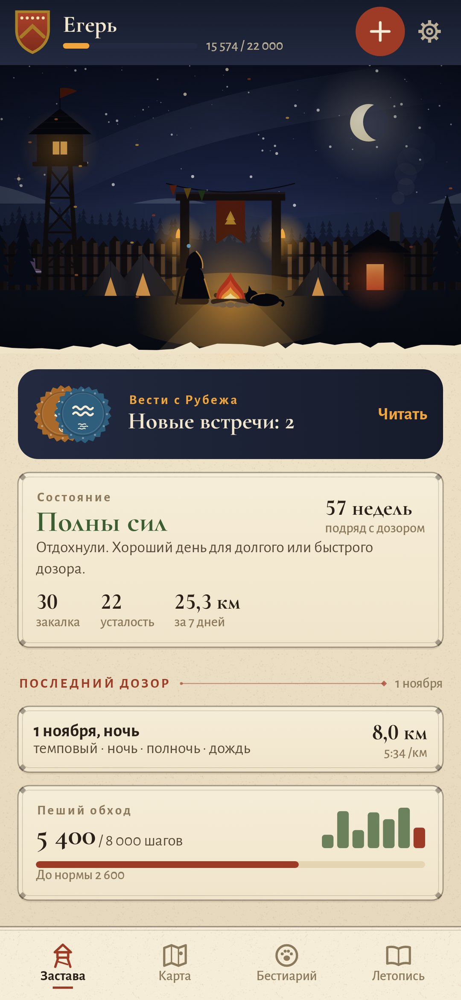
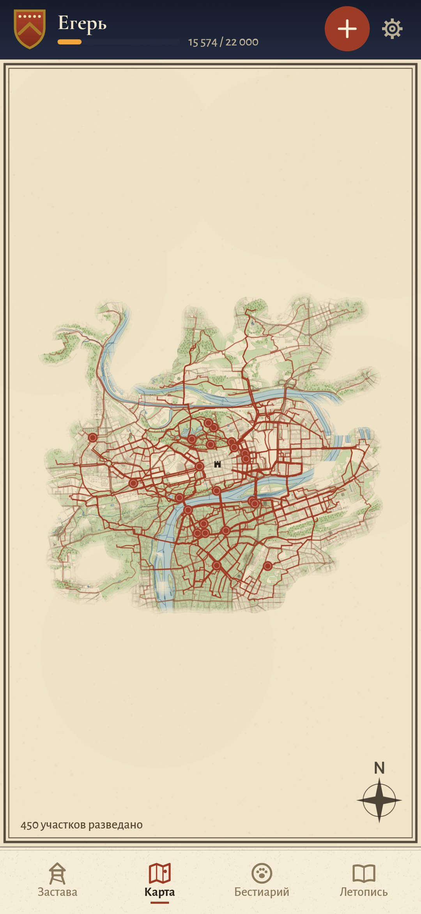
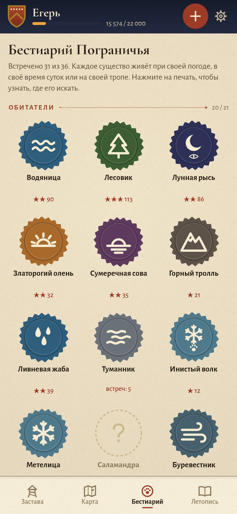
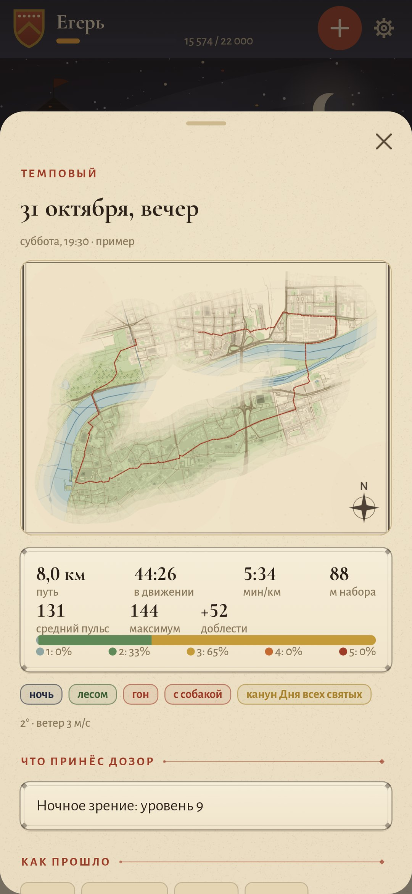

<div align="center">



# Следопыт

### Беговой дневник, в котором каждая пробежка — дозор на краю королевства

*Вы следопыт Пограничья. Пробежки приходят из Health Connect, с часов или из архива Strava и становятся дозорами. Кого вы встретите, решает сама пробежка: дождь, туман, рассвет, полнолуние, река вдоль пути, подъёмы, спокойный пульс или рывки. Застава растёт вместе со званием, а на карте проступает только та земля, где вы уже бегали. Бесплатно, без рекламы и без аккаунтов.*

[](https://github.com/bigdevwhale/ranger/actions/workflows/android.yml)
[](https://github.com/bigdevwhale/ranger/releases/latest)


[](LICENSE)

[English](README.md) · **Русский** · [Изменения](CHANGELOG.md)

   

**[Скачать APK](https://github.com/bigdevwhale/ranger/releases/latest/download/Ranger.apk)** · Android 9+

</div>

---

## Откуда берутся пробежки

- **Health Connect.** Туда пишут Strava, Garmin, Samsung Health, Mi Fitness, Zepp, Polar и Coros. Приложение читает пробежки с маршрутом и пульсом, утренний пульс покоя, вариабельность пульса и шаги за день.
- **Файлы.** GPX, TCX и FIT с любых часов, в том числе сжатые и в zip.
- **Архив Strava.** «Настройки → Мой аккаунт → Скачать или удалить аккаунт», и потом весь zip целиком. За один раз приезжают годы пробежек вместе с кроссовками.
- **Своя запись** по GPS, если часов нет, или пробежка вручную.

Если одна и та же пробежка пришла из двух мест, остаётся одна копия: та, где есть трек и пульс.

## Бестиарий

В Пограничье живут 57 существ, и у каждого свои условия. Водяница появляется, если бежать вдоль воды. Лунная рысь выходит в темноте, Златорогий олень на рассвете. Горный тролль ждёт на подъёмах, Ветрогон даётся только рывками, а Шептунья показывается тому, кто бежит спокойно, в лёгких пульсовых зонах. Есть редкие гости, например Болотный огонёк (ночь и дождь) или Оборотень (полнолуние). Есть и легенды: Ледяной единорог на морозном рассвете, Древний дракон за тридцать километров, Жар-птица в купальскую ночь.

Обычное существо находится за несколько дозоров: сначала вы видите следы, потом логово, потом встречаете его самого. Погоду приложение узнаёт по месту и времени пробежки (Open-Meteo), солнце и луну считает само, а воду, парки и леса вдоль пути берёт с карты OpenStreetMap.

## Звания, умения и состояние

- **Доблесть** — это тренировочная нагрузка (TRIMP): время с учётом того, насколько высоко был пульс. Без пульса она считается по темпу и набору высоты. Час лёгкого бега и полчаса тяжёлого стоят примерно одинаково. За ходьбу тоже немного начисляется.
- **Десять званий**, от новобранца до Легенды Пограничья. С каждым званием на заставе появляется что-то новое: частокол, вышка, ворота со знаменем, кузня, каменная стена, донжон, сигнальный огонь на холме.
- **Девять умений** растут каждое от своего: выносливость, быстрота, ночное зрение, горная тропа, стойкость в непогоду, тихий шаг, чутьё следа, постоянство и умение «Ходок» за дни, когда пройдена норма шагов.
- **Состояние** складывается из закалки за шесть недель и усталости за неделю. Если нагрузка растёт слишком быстро или утром пульс покоя выше обычного, знахарка посоветует отдохнуть.

## Застава, карта, летопись

- **Застава** — ночной или дневной лагерь под настоящим небом: фаза луны, время суток и время года совпадают с реальными. В лагере стоят палатки спутников, у костра спит собака, если вы бегаете с ней, на стене висят отслужившие кроссовки, а над воротами — флажки со стартов.
- **Карта** нарисована на пергаменте по данным OpenStreetMap. Видно только разведанное вдоль ваших троп, а встречи с существами отмечены печатями. Вокруг дома и работы треки обрезаются.
- **Походы** — цели на несколько недель: «Старый тракт» (80 км за месяц), «Горный перевал», «Ночной дозор», «Тихий шаг» и другие.
- **Летопись**: календарь, недельные километры, пульсовые зоны и доля лёгкого бега, кривая закалки и усталости, пульс покоя, шаги, рекорды на 1, 5 и 10 км, полумарафоне и марафоне.
- **Сапоги, отряд и бард.** У каждой пары кроссовок свой пробег. Спутники получают роли по тому, как вы бегаете вместе. Приложение может запоминать, какой трек играл в наушниках, и подскажет, под какую музыку вы бежите быстрее.

## Приватность

Всё хранится на телефоне. Аккаунтов, рекламы и аналитики нет. В интернет уходят только запросы тайлов карты (OpenFreeMap) и погоды (Open-Meteo) по координатам пробежек. Из Health Connect приложение только читает и ничего туда не пишет. Музыку оно узнаёт по уведомлению плеера, и то только если вы дали на это разрешение.

## Сборка

```
./gradlew assembleDebug                      # app.ranger.dev, рядом с настоящей установкой
./gradlew assembleDebug -Pdemo               # app.ranger.demo: год дозоров вокруг Летны в Праге
./gradlew testDebugUnitTest                  # форматы GPX/TCX/FIT/Strava, условия, бестиарий, шаги
./gradlew testDebugUnitTest -Prender --tests '*RenderScreens*' --rerun && python tools/shots.py   # скриншоты
python tools/demo_routes.py                  # заново собрать демо-маршруты, рельеф и тайлы
```

Kotlin, Jetpack Compose, Room, DataStore, Health Connect. Сцена заставы, печати и карта нарисованы в коде. Шрифты: Cormorant и Alegreya Sans (SIL OFL). Данные карты © участники OpenStreetMap (ODbL), тайлы OpenFreeMap, погода Open-Meteo (CC BY 4.0).

Часть [StillCraft](https://bigdevwhale.github.io/stillcraft/). Лицензия MIT.
